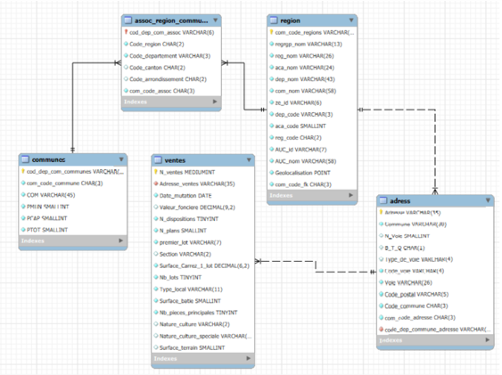
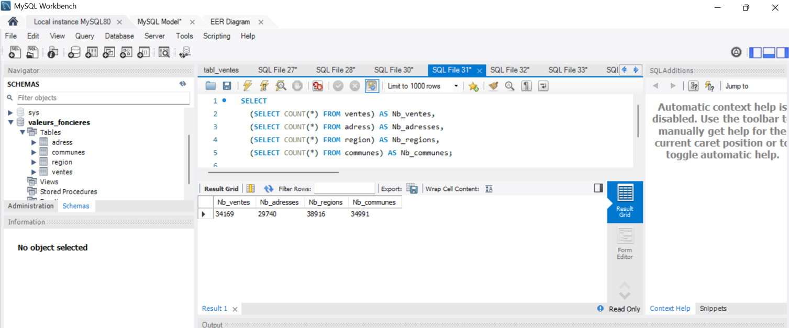
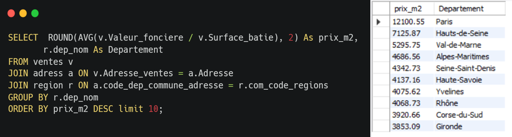

# Créer-et-exploiter-une-BDD-immobiliére-avec-SQL

SQL · MySQL · Modélisation · Formation

Conception d'une base de données relationnelle à partir de trois sources open data (ventes immobilières, population, référentiel géographique), puis exploitation par 12 requêtes SQL pour comprendre le marché immobilier du 1er semestre 2020.

## Contexte

Ce projet a été réalisé dans le cadre de ma formation de Data Analyst chez OpenClassrooms. Dans le scénario, DATAImmo, un réseau national d'agences immobilières, veut prédire le prix des biens, aider ses agences à les tarifer et maximiser le retour sur investissement de chaque vente.

Ma mission : construire la base de données qui servira de socle à ce futur modèle de prédiction, en respectant le RGPD, puis la documenter et l'exploiter.

## Démarche

1. **Analyse des sources et conformité RGPD**
   - Trois sources open data : les demandes de valeurs foncières (DVF), les résultats du recensement de l'INSEE et le référentiel géographique français
   - Réflexion sur la conformité RGPD des données de transactions immobilières

2. **Dictionnaire de données**
   - Pour chaque variable : signification, type, longueur, nature (élémentaire ou concaténée), règle de gestion (`NOT NULL`, valeurs autorisées) et règle de calcul
   - Construction des clés composites, par exemple la concaténation du code département et du code commune pour relier les tables

3. **Modèle relationnel normalisé**
   - 4 tables : `ventes`, `adress`, `region`, `communes`
   - Relations : une adresse pour plusieurs ventes, une commune pour plusieurs adresses, une région pour plusieurs communes
   - Respect des trois premières formes normales (clé primaire dans chaque table, attributs atomiques, pas de dépendances partielles ni transitives)

4. **Implémentation dans MySQL Workbench**
   - Création des tables, contraintes d'intégrité et chargement des données
   - Contrôle de la volumétrie après import : 34 169 ventes, 29 740 adresses, 38 916 lignes de référentiel, 34 991 communes

5. **Exploitation par requêtes SQL**
   - Jointures sur 3 à 4 tables, agrégations (`COUNT`, `AVG`), regroupements, filtres (`WHERE`, `HAVING`), sous-requêtes, `CASE WHEN`, expressions de table commune (`WITH`) et fonctions de fenêtrage

## Résultats

- **31 378 appartements vendus au 1er semestre 2020**, dont **14 465 en Île-de-France** (46 %), loin devant PACA (3 611) et Auvergne-Rhône-Alpes (3 156)
- Les petites surfaces dominent : **28,7 % des ventes** sont des 2 pièces, **26,3 %** des 3 pièces
- Le prix moyen au m² est le plus élevé à **Paris (≈ 12 100 €)**, devant les Hauts-de-Seine (≈ 7 130 €) et le Val-de-Marne (≈ 5 300 €). Une maison en Île-de-France se vend en moyenne **3 957 €/m²**.
- Le nombre de ventes augmente de **3,7 %** entre le 1er trimestre (16 776) et le 2e trimestre (17 393)
- Un 2 pièces coûte environ **11 % plus cher au m²** qu'un 3 pièces (4 768 € contre 4 228 €)

## Aller plus loin : analyses complémentaires

- **Fonction de fenêtrage et CTE** : classement des 3 communes les plus chères de cinq départements (6, 13, 33, 59 et 69) avec `ROW_NUMBER() OVER (PARTITION BY ...)`
- **Croisement avec les données du recensement** : calcul des transactions pour 1 000 habitants dans les communes de plus de 10 000 habitants, pour mesurer l'intensité du marché et non seulement son volume
- **Réflexion sur la définition du prix au m²** : j'ai comparé la surface Carrez et la surface bâtie, et documenté le choix retenu
- **Contrôle de la qualité des données** : repérage de biens à 0 pièce, vérification de la couverture des dates en juin 2020, détection de surfaces incohérentes (par exemple un appartement de 10 m² vendu 9 M€, probablement une vente multi-lots)
- **Dictionnaire de données complet** sur trois sources, avec règles de gestion et règles de calcul

## Réalisations

**Top 3 des communes par département, par valeur foncière moyenne (SQL)**

```sql
WITH Moyennes AS (
    SELECT
        r.dep_code AS Departement,
        c.COM AS Commune,
        ROUND(AVG(v.Valeur_fonciere), 2) AS Moyenne_des_valeurs_foncieres,
        ROW_NUMBER() OVER (
            PARTITION BY r.dep_code
            ORDER BY AVG(v.Valeur_fonciere) DESC
        ) AS rang
    FROM ventes v
    JOIN adress a   ON v.Adresse_ventes = a.Adresse
    JOIN region r   ON a.code_dep_commune_adresse = r.com_code_regions
    JOIN communes c ON a.code_dep_commune_adresse = c.cod_dep_com_communes
    WHERE r.dep_code IN (6, 13, 33, 59, 69)
    GROUP BY r.dep_code, c.COM
)
SELECT Departement, Commune, Moyenne_des_valeurs_foncieres
FROM Moyennes
WHERE rang <= 3
ORDER BY Departement, Moyenne_des_valeurs_foncieres DESC;
```


*Schéma relationnel normalisé*


*Base de données créée et alimentée*


*Les 10 départements au prix au m² le plus élevé*

## Stack

`MySQL` · `MySQL Workbench` · `SQL` · `Excel`

[Voir le projet complet sur GitHub →]()
[Retour à la liste de projets →]()
